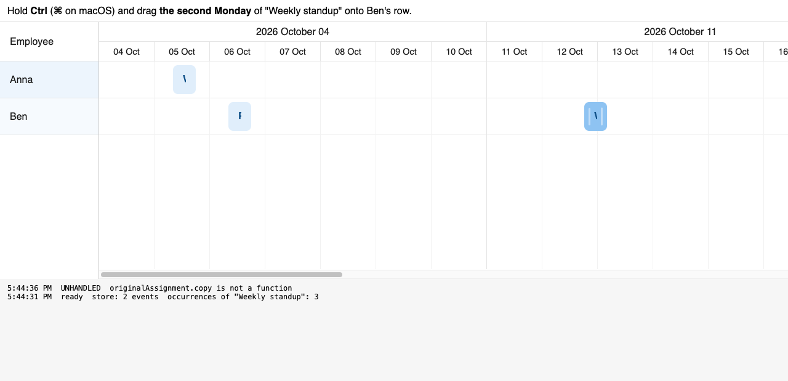

# Ctrl/⌘ + drag of a recurring event occurrence throws instead of copying

Minimal repro for a question on the Bryntum forum. Scheduler Pro 7.3.7, plain JS + Vite.

## Run

```sh
npm install   # needs access to npm.bryntum.com (licensed or trial account)
npm run dev
```

Open the URL Vite prints.

## Steps

1. Hold **Ctrl** (**⌘** on macOS).
2. Press on **the second Monday** of "Weekly standup" (Anna, 12 Oct) and drag it onto Ben's row.
3. Release.

Nothing is created and the drop throws:

```
TypeError: originalAssignment.copy is not a function
    at EventDrag.updateAssignments
    at EventDrag.updateRecords
    at EventDrag.finalize
    at RecurrenceConfirmationPopup.changerFn
    at RecurrenceConfirmationPopup.processSingleRecord
    at SchedulerPro.onRecurrableBeforeEventDropFinalize
```

The store still holds 2 events, and the original bar is left drawn on the row it was dropped on.



The same gesture on "Plain shift" (Ben, 6 Oct) copies fine, so the failure is specific to an occurrence.

## What we think happens

`EventDrag.updateAssignments` copies the **assignment**:

```js
if (copy) {
    draggedAssignment = originalAssignment.copy();
}
```

An occurrence's assignment is synthetic (`isOccurrenceAssignment`), so it has no `copy()`.

Checked on 7.0.2 and 7.3.7, same error. The call is already there in 6.3.4, so it does not look recent. `changeMode` guards `isRecurring`, which catches the master record but not its occurrences.
