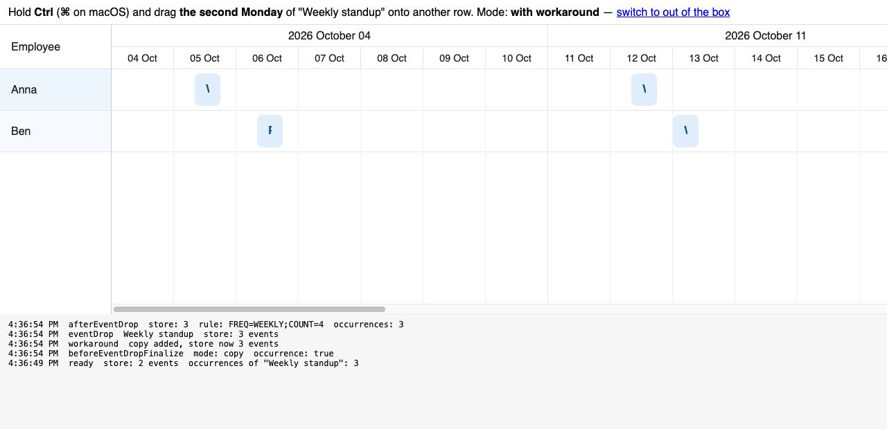

# Copying one occurrence of a recurring event with Ctrl/⌘ + drag

Minimal repro for a question on the Bryntum forum. SchedulerPro 7.3.7, plain JS + Vite.

## Run

```sh
npm install   # needs access to npm.bryntum.com (licensed or trial account)
npm run dev
```

Open the URL Vite prints. `?workaround` in the URL switches the workaround on.

## Steps

1. Hold **Ctrl** (**⌘** on macOS).
2. Press on **the second Monday** of "Weekly standup" (Anna, 12 Oct) and drag it onto Ben's row.
3. Release.

**Out of the box:** nothing is created and the drop throws.

```
TypeError: originalAssignment.copy is not a function
    at EventDrag.updateAssignments
    at EventDrag.updateRecords
    at EventDrag.finalize
    at RecurrenceConfirmationPopup.changerFn
    at RecurrenceConfirmationPopup.processSingleRecord
    at SchedulerPro.onRecurrableBeforeEventDropFinalize
```

The store still holds 2 events, and the original bar is left drawn on the row it was dropped on.


**With `?workaround`:** a plain event is added where it was dropped, the series keeps all its dates, and the original is drawn back on its own date.



Same gesture on "Plain shift" (Ben) copies fine in both modes — the failure is specific to an occurrence.

## What we think happens

`EventDrag.updateAssignments` copies the **assignment**:

```js
if (copy) {
    draggedAssignment = originalAssignment.copy();
}
```

An occurrence's assignment is synthetic (`isOccurrenceAssignment`), so it has no `copy()`.

`EventCopyPaste` does not go through that path — it copies the **event** (`event.copy(null, true)`), which works on an occurrence. Pasting an occurrence does succeed, but it carries `recurrenceRule` over, so you get a second full series rather than one date.

## Questions

1. **Is there a supported way to copy a single occurrence as a plain event?** We want the series left untouched and one non-recurring event created at the drop point. If there is no supported way today, would you consider it?

2. **How should the original's bar be redrawn?** During a copy the drag moves the original's own element by inline style. Our `updateRecordsFn` skips the native drop, and the following redraw then finds a DOM config equal to the cached one and skips the element, so the original stays drawn on the target row. The only thing we found that works is deleting the private per-element cache:

   ```js
   eventBarEls.forEach(eventBarEl => delete eventBarEl.lastDomConfig);
   this.client.refreshRows();
   ```

   `refreshRows()` / `refresh()` / `refreshWithTransition()` on their own do not bring it back. Is there a public way to tell the renderer an element was moved behind its back?

   It also has to run in the drop's own frame: past an `await` the browser has already painted the bar at the drop point, and the redraw then animates it home instead of snapping, which reads as a refused move.

## The workaround

See `main.js`:

- `beforeEventDropFinalize` returns `false` on a copy of an occurrence, which stops `onRecurrableBeforeEventDropFinalize` without cancelling the drop, so the original is never detached from its series.
- `updateRecordsFn` builds the copy from the event record with `recurrenceRule` and `exceptionDates` cleared, adds it to the store and places it on the drop's day and row.
